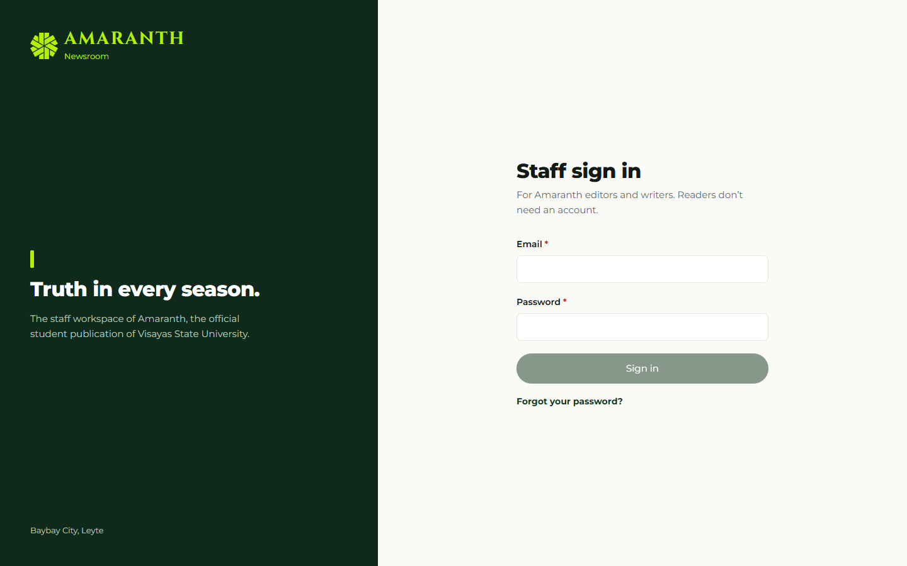
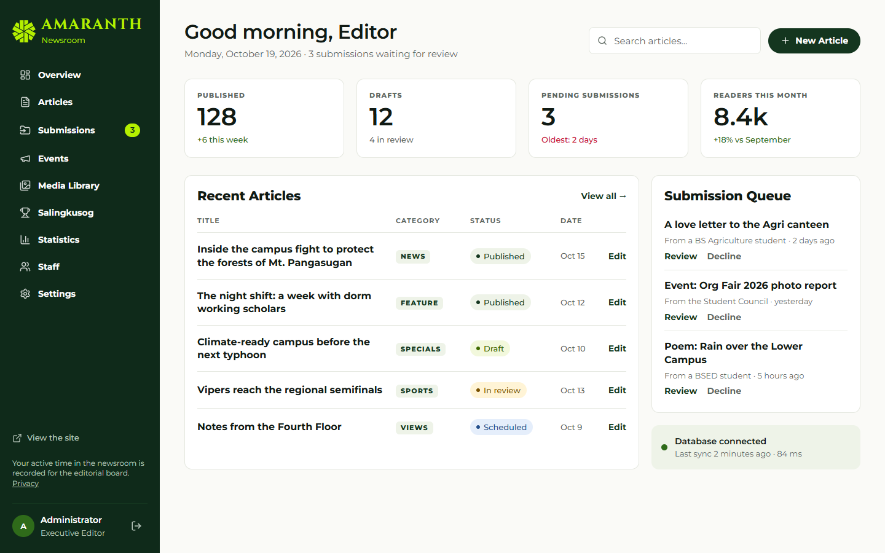
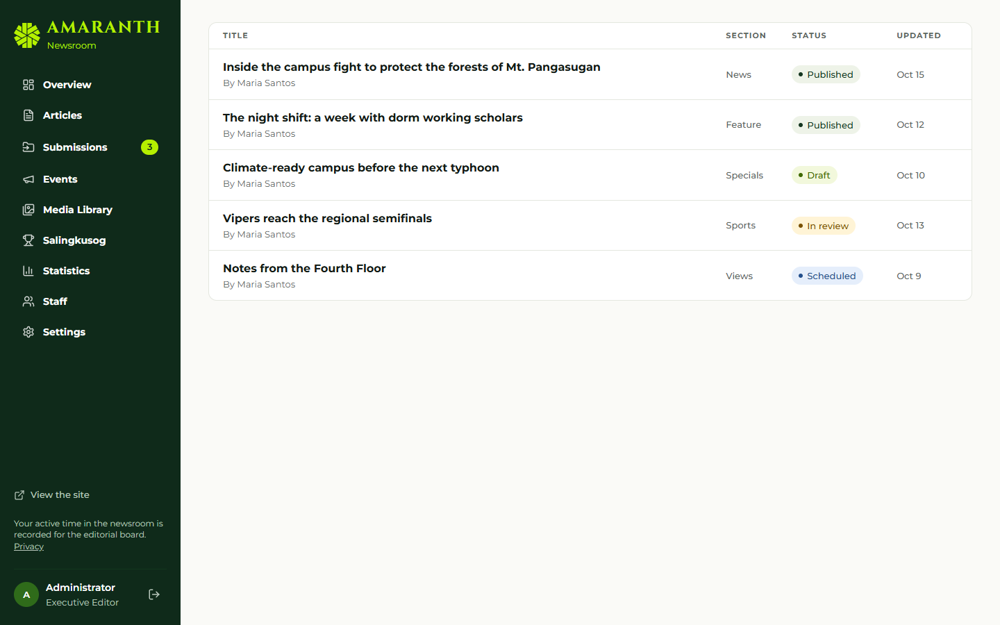
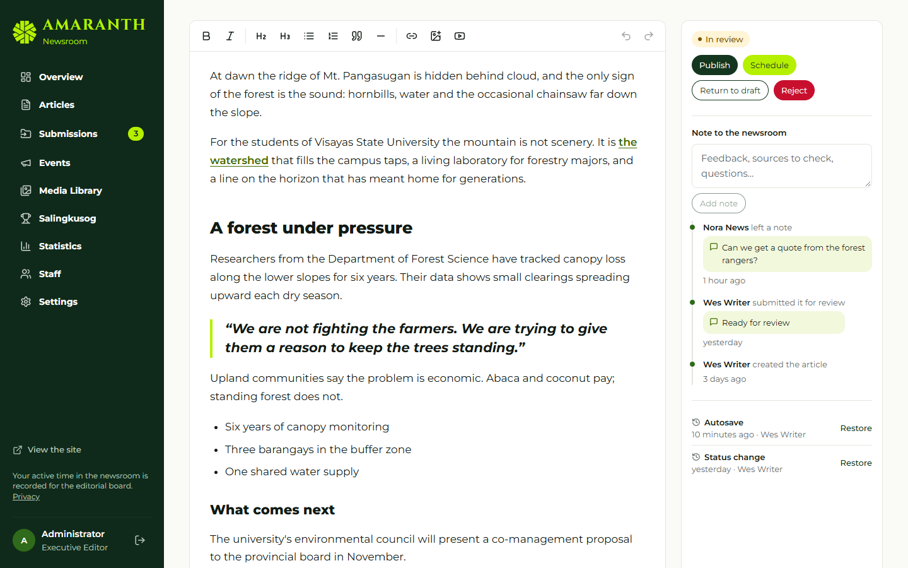
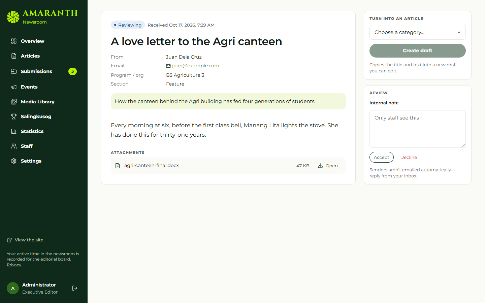
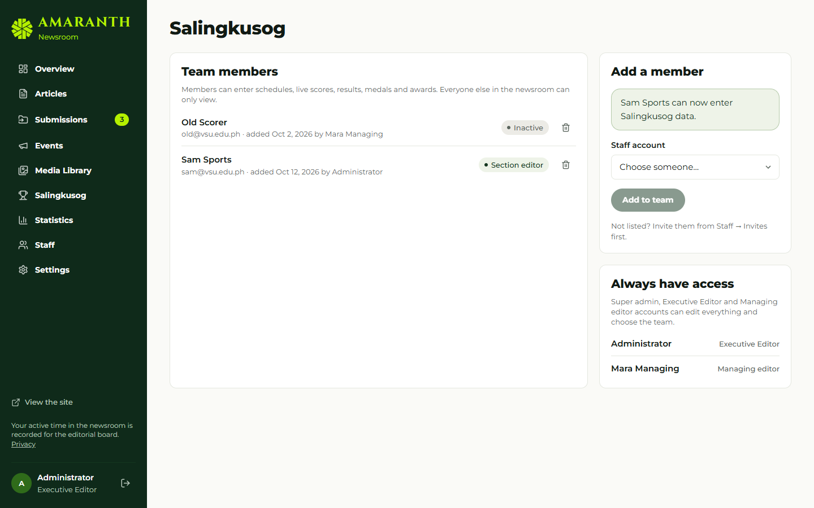

# Document control

| Field | Value |
|---|---|
| Title | User Manual — Executive Editor, Managing Editor and Super Admin |
| Document ID | AMR-DOC-11a |
| Version | 1.0 |
| Date | 2026-10-19 |
| Author | Amaranth development team [TO CONFIRM: names] |
| Status | Final draft |
| Screens | Captured from the development fixture screens with fictional data |

# Contents

1. Who this manual is for
2. Signing in
3. The newsroom at a glance
4. Managing staff
5. Publishing: review, publish, schedule, archive
6. Giving publishing access to staff
7. The front page and the ticker
8. Settings
9. Moderation: comments, inbox, submissions, events
10. Statistics
11. Salingkusog oversight
12. Good practice

\newpage

# 1. Who this manual is for

| You are | Role in the system | What only you can do |
|---|---|---|
| Executive Editor (Editor-in-Chief) | `editor_in_chief` | Everything below except granting the Super admin role |
| Super admin | `super_admin` | Everything, including granting or removing Super admin |
| Managing Editor | `managing_editor` | Publish, front page, ticker, editorial board, print issues, statistics, publishing access, Salingkusog team — but not roles, invites or general settings |

Writing and editing articles is covered in AMR-DOC-11b; Salingkusog data entry in AMR-DOC-11c.

# 2. Signing in

1. Go to `/admin/login` (or "Staff login" in the site footer).
2. Enter your email and password, then **Sign in**.
3. Forgot your password? Choose **Forgot password**, enter your email, and follow the link in the email to set a new one.

If you see **Access pending**, your account has not been invited or has been deactivated; ask the Super admin.

# 3. The newsroom at a glance

The left menu shows **Overview, Articles, Submissions, Events, Media Library, Salingkusog, Statistics, Staff, Settings**. Items you cannot use are hidden. The **Overview** dashboard shows published, scheduled, drafts and in-review counts, and article views this month compared with last month.

# 4. Managing staff (Executive Editor, Super admin)

**Invite someone**

1. **Staff → Invites**.
2. Enter the **Email**, choose the **Role**, and for a Section editor tick the **Sections** they will edit.
3. Save. Then, in Supabase, send the invitation email (Authentication → Invite user) [TO CONFIRM who does this step]; when they accept, their account is active with that role.

**Change a role or deactivate**

1. **Staff → Accounts → Edit** next to the person.
2. Change the **Role**, the sections, or untick **Active — can sign in to the newsroom**.
3. **Save**. The change is recorded in the audit log.

Rules the system enforces: only a Super admin can make or remove another Super admin; you cannot deactivate yourself; at least one active Super admin must remain.

**Contributors and editorial board**

- **Staff → Contributors**: public bylines (staff, student, guest, faculty, alumni). Editors can add and edit them.
- **Staff → Editorial board** (Executive Editor, Managing Editor, Super admin): terms and members shown on the public Editorial Board page.

# 5. Publishing: review, publish, schedule, archive

Open **Articles**. Use the tabs **All, Mine, Drafts, Needs review, Scheduled, Published**, the section and status filters, or search by title.

Open an article. The **Status** panel on the right shows only the actions you are allowed to take:

| Button | Effect |
|---|---|
| **Start review** | Submitted → In review (tells the writer you are on it) |
| **Return to draft** | Back to the writer, with your note |
| **Reject** | Rejected (a note is required) |
| **Publish** | Live now |
| **Schedule** | Pick a future date and time; it goes live by itself |
| **Archive** | Removes a published article from the site (it can be restored) |

Use **Note to the newsroom → Add note** to leave feedback without changing the status. **Notes & activity** shows who did what; **Revisions** lets you restore an earlier version. **Article settings** lets editors tick **Feature on the front page**.

# 6. Giving publishing access to staff (Executive Editor, Managing Editor, Super admin)

By default only the Super admin, Executive Editor, Managing Editor and Business Manager can publish or schedule. To trust a writer or section editor with publishing:

1. **Staff → Accounts → Edit** next to the person.
2. Under **Publishing**, tick **Can publish and schedule articles**.
3. **Save**. The change is audited. Untick it to take the access back.

The Business Manager can publish but cannot give access to others.

# 7. The front page and the ticker (Executive Editor, Managing Editor, Super admin)

**Settings → Front page**:

- choose the **lead story**;
- choose the **literary folio** piece, with a **Pull quote** and **Attribution**;
- the latest-news ticker: **Show** "The newest headlines" or "My own announcements", and **How many**.

# 8. Settings (Executive Editor, Super admin)

| Tab | What you manage |
|---|---|
| Front page | Lead story, folio pick, ticker (also Managing Editor) |
| Comments | Moderation queue |
| Inbox | Contact form messages |
| Sections | Section names, descriptions, menu placement (main menu or "More"), order, whether they accept submissions; categories, including categories reserved for editors |
| Desks | Desk contacts shown on the Contact page |
| General | Site details, social links (web addresses only), comments on/off |

# 9. Moderation: comments, inbox, submissions, events

- **Settings → Comments**: approve, reject or mark as spam. Comments are hidden until approved.
- **Settings → Inbox**: contact messages; mark in progress, resolved or spam.
- **Submissions** and **Events**: open an item, read it and its **Attachments**, write a **Review** note, then **Decline**, accept, or **Turn into an article** by choosing a **Category for the new article**. The draft opens in the editor and the submission is marked converted.

# 10. Statistics (Executive Editor, Managing Editor, Super admin)

**Statistics** shows, for the date range you choose: pageviews, article views, readers, average read time, shares, a daily trend, top articles, authors, sections, traffic sources and referrers, devices and browsers, share channels, and staff active time (H:MM:SS). Each figure compares with the previous period.

Privacy: no cookies are set on readers, IP addresses are not stored, readers who ask browsers not to track are counted only as an anonymous pageview, and individual visits are deleted after 13 months (see `/privacy`).

# 11. Salingkusog oversight (Executive Editor, Managing Editor, Super admin)

- **Salingkusog → Team**: add or remove the staff who may enter Salingkusog data. You three always have access.
- **Salingkusog → Edition**: dates, medal points, publish the edition, and switch the countdown page on or off.
- **Results & medals**: confirm medals when an event shows **Ready to confirm**. Nothing counts in the medal tally until someone saves the results.

Full Salingkusog procedures: AMR-DOC-11c.

# 12. Good practice

- Give publishing access sparingly and review it each semester.
- Deactivate accounts of members who leave.
- Keep at least two people who can publish during events.
- Before the games, check the event-week checklist (AMR-DOC-09 §10).
