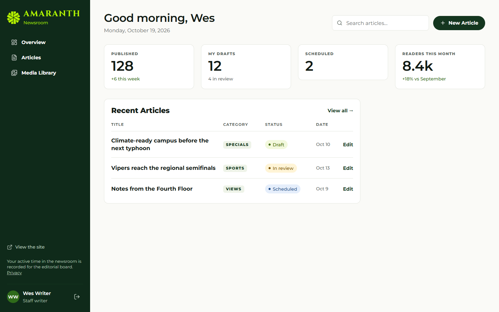
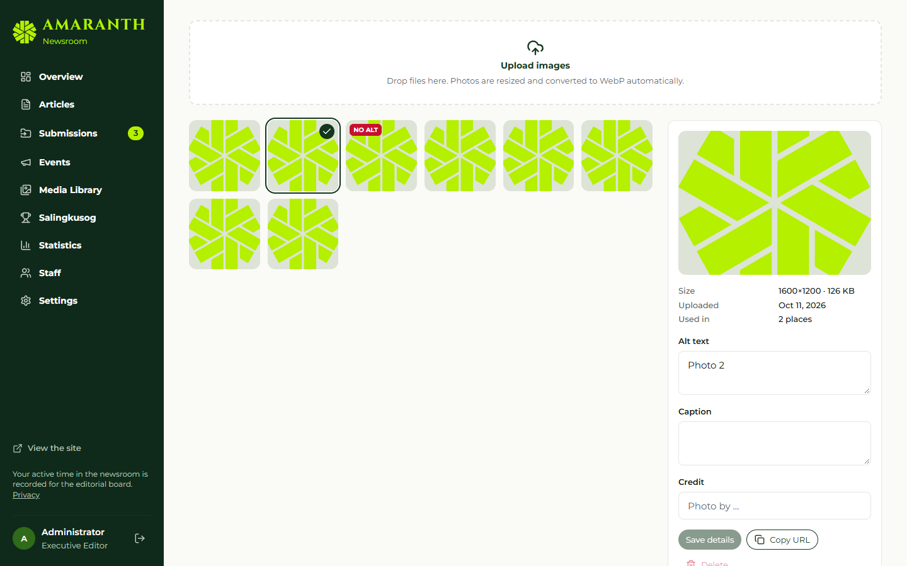

# Document control

| Field | Value |
|---|---|
| Title | User Manual — Editors and Staff |
| Document ID | AMR-DOC-11b |
| Version | 1.0 |
| Date | 2026-10-19 |
| Author | Amaranth development team [TO CONFIRM: names] |
| Status | Final draft |

# Contents

1. What you can do
2. Signing in
3. Writing an article
4. Submitting for review
5. Reviewing (Section editors)
6. Publishing (if you have access)
7. Media library
8. Your byline
9. Tips and messages you may see

\newpage

# 1. What you can do

| Role | Write drafts | Submit for review | Review and edit your sections | Publish / schedule | Moderate and review submissions |
|---|---|---|---|---|---|
| Staff writer, Contributor | ✔ | ✔ | — | only if given access | — |
| Section editor | ✔ | ✔ | ✔ (assigned sections) | only if given access | ✔ |
| Business Manager | ✔ | ✔ | — | ✔ | — |

You see your own articles, articles you co-author, and (Section editors) every article in your sections.

# 2. Signing in

Go to `/admin/login`, enter your email and password and choose **Sign in**. Use **Forgot password** if needed. Your dashboard shows your drafts and recent articles.

# 3. Writing an article

1. **Articles → New article** (also on the dashboard).
2. Choose a **category** (this sets the section). Some categories are reserved for editors.
3. Write the title and the body. The toolbar has bold, italic, headings, lists, quotes, a divider, links, images from the media library and video embeds.
4. Fill in the side panels:
   - **Tags & summary**: kicker, dek (subtitle) and tags;
   - **Cover photo**: choose from the media library and write a caption;
   - **Byline**: authors (you are added automatically) or a byline override such as "By Sports Desk";
   - **Search & sharing**: SEO title, description and social image, with a **Search result preview**;
   - **Article settings**: **Allow comments**.
5. Your work **saves automatically** 2.5 seconds after you stop typing. **Revisions** keeps the last 50 versions; choose **Restore** to go back.

# 4. Submitting for review

When the draft is ready, choose **Submit for review** (add a note if useful). The article is then locked for you; you can **Return to draft** (withdraw) while it is still waiting. Your editor's notes appear under **Notes & activity**. If it is returned or rejected, revise it and submit again.

# 5. Reviewing (Section editors)

1. **Articles → Needs review** shows submitted articles in your sections.
2. Open one and choose **Start review**.
3. Edit as needed, then either **Return to draft** with a note, or **Reject** (a note is required), or — if you have publishing access — publish or schedule it.
4. You can tick **Feature on the front page** for articles in your sections.

# 6. Publishing (if you have access)

The Business Manager always has it; others only if the Executive Editor, Managing Editor or Super admin turned on **Can publish and schedule articles** for them.

- **Publish** makes the article live now.
- **Schedule** asks for a future date and time; the article goes live on its own at that time.
- **Archive** takes a published article off the site; it can be published again later.

If you try something you are not allowed to do, the newsroom explains it (for example "You cannot move this article from draft to published").

# 7. Media library

1. **Media Library → Upload images**. Images are resized and compressed automatically.
2. Open an image to add **alt text** (required for accessibility; images without it are flagged "No alt"), a caption and a credit.
3. Search by text, or show **My uploads** only.
4. An image that is **Used in** an article, logo or issue cannot be deleted until it is replaced.

# 8. Your byline

Your public byline (name, position, program, bio, photo) is a contributor profile. Editors manage contributors in **Staff → Contributors**; ask your section editor to update yours.

# 9. Tips and messages you may see

| Message | Meaning |
|---|---|
| "This article is locked while it is submitted" | Wait for the editor, or withdraw it with Return to draft |
| "This category is reserved for editors" | Choose another category or ask an editor |
| "Pick a future time to schedule" | The chosen time is in the past |
| "Only editors can feature or prioritise articles" | Featuring is for section editors and above |
| "Access pending" | Your account is not active yet; contact the Executive Editor |
