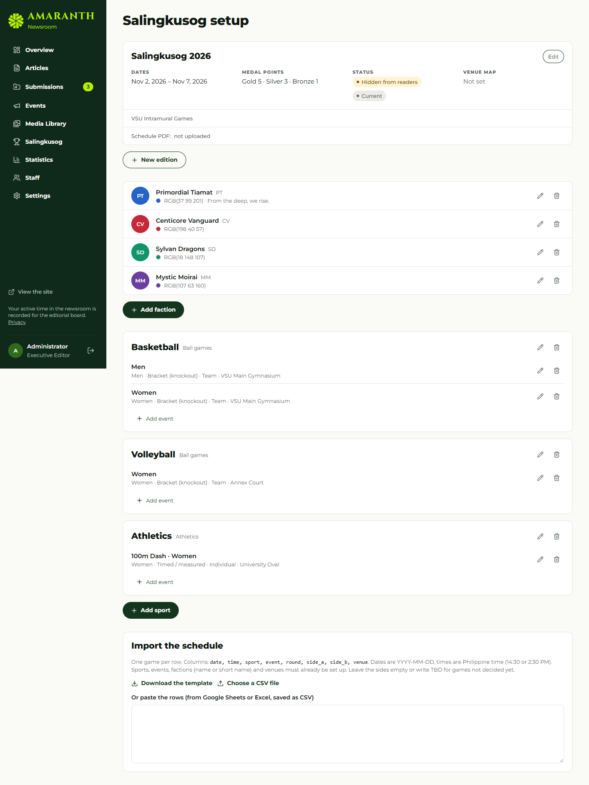
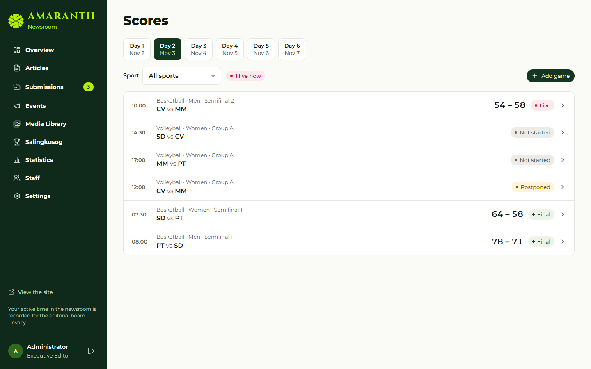
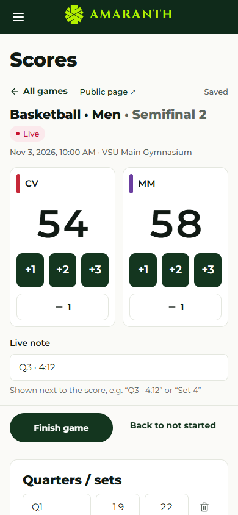
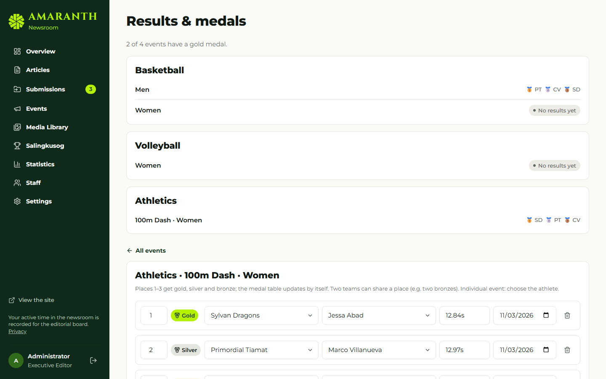
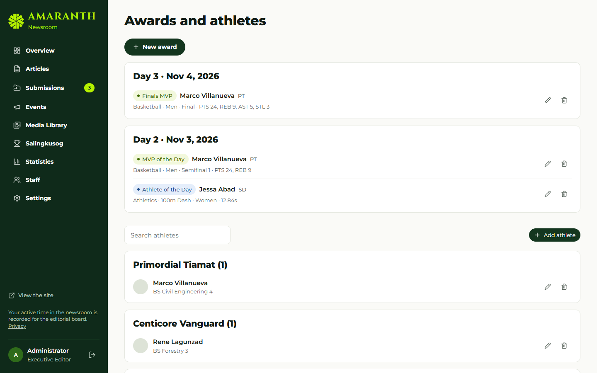
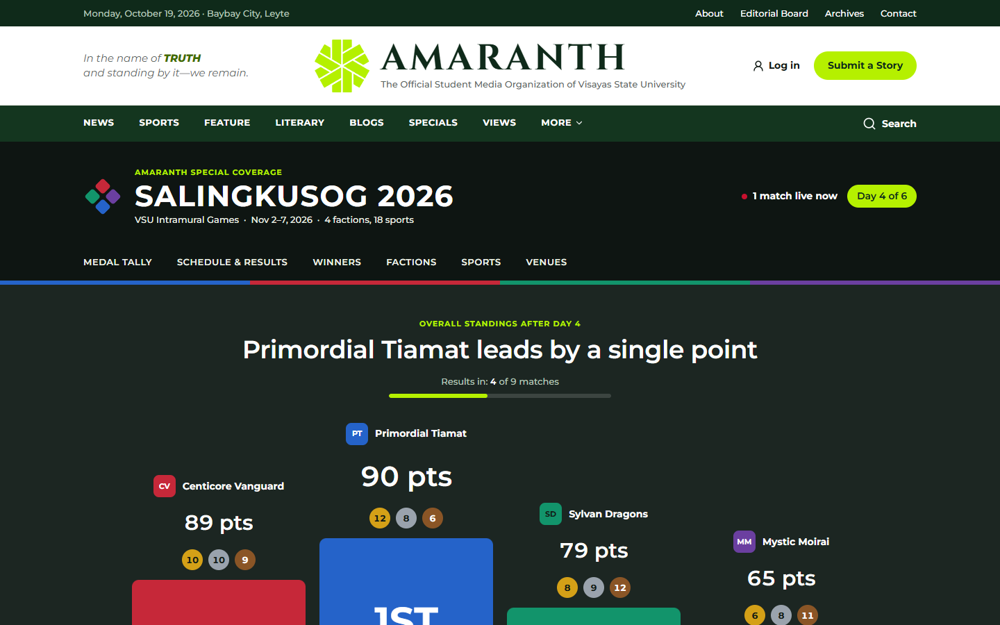

# Document control

| Field | Value |
|---|---|
| Title | User Manual — Salingkusog Team |
| Document ID | AMR-DOC-11c |
| Version | 1.0 |
| Date | 2026-10-19 |
| Author | Amaranth development team [TO CONFIRM: names] |
| Status | Final draft |
| Screens | Development fixture screens with fictional factions and athletes |

# Contents

1. Who can do what
2. The Salingkusog newsroom
3. Before the games: setup
4. Creating the schedule (three ways)
5. Keeping live scores
6. Contests (dance, swimming, athletics, painting…)
7. Results and medals
8. Awards and social cards
9. What readers see
10. Troubleshooting

\newpage

# 1. Who can do what

- **Super admin, Executive Editor, Managing Editor:** everything, plus choosing the team (**Team** tab) and the countdown.
- **Team members** (any staff added in **Team**): all setup, schedules, scores, results and awards.
- **Other staff:** can view but not change.

# 2. The Salingkusog newsroom

**Salingkusog** in the newsroom menu has these tabs: **Scores, Results & medals, Awards, Athletes, Edition, Factions, Sports & events, Venues, Schedule import, Team**.

# 3. Before the games: setup

Do these in order (about two weeks before):

1. **Edition** — year, title, start and end dates, medal points (default Gold 5, Silver 3, Bronze 1), schedule PDF, venue map. Keep **Published** off until you are ready; only one edition can be current.
2. **Factions** — name, short name (e.g. "PT"), motto, colour and logo for each team.
3. **Venues** — name, description, and the number and position on the venue map.
4. **Sports & events** — add each sport with its category, then its events:
   - **Division:** men, women, mixed or open;
   - **Format:** Bracket (knockout), Round robin, Round robin + final, Timed / measured, or Judged;
   - **Team event** or individual;
   - **Result unit** for timed or measured events: **s** = fastest wins; **m** or **pts** = highest wins;
   - main venue.
5. **Athletes** — name, program (course and year) and an optional photo, per faction. Only publish photos with the athlete's consent [TO CONFIRM consent process].



# 4. Creating the schedule (three ways)

| Use | For | How |
|---|---|---|
| **Build schedule** | Brackets and round robins (team or individual, e.g. basketball, chess, arnis, kyorugi) | Sports & events → **Build schedule** on the event |
| **Create contest** | Events where every faction competes at once (dance, Pinoy pop, folkdance, hip-hop, painting, swimming, athletics) | Sports & events → **Create contest** on the event |
| **Schedule import (CSV)** | Any games you already have in a spreadsheet | Schedule import tab |

## 4.1 Build schedule

1. Choose the **format**: Single elimination (with optional bronze game; top seeds get a bye if the field isn't 2, 4, 8 or 16), Round robin (everyone plays everyone once; each round fills in once the previous round is finished), or Round robin + final (1st v 2nd in the final, 3rd v 4th in the bronze game).
2. Put the factions in **seed order** (seed 1 strongest) with the arrows; untick factions not taking part.
3. Set the **First game** time, **Hours between rounds** (24 = one round a day), **Minutes between games** within a round, and the **Venue**.
4. Check the line "Creates N games over R rounds", then **Create games**. A list of the created games appears.

You only enter scores from now on: winners (and semifinal losers for the bronze game) move on by themselves. The system refuses to build if a game has been played, or if the last round would fall after the games end.

## 4.2 Create contest

Choose the start time, a name (usually "Final"), the venue, the performance order (faction order or **Random draw**), and tick the factions taking part. **Create contest** opens the contest scorekeeper (section 6).

## 4.3 CSV import

The file must have a header row. Columns (other accepted names in brackets):

| Column | Example | Rules |
|---|---|---|
| `date` (`day`) | 2026-10-26 | YYYY-MM-DD, within the edition's dates |
| `time` (`start`) | 08:00 or 2:30 PM | 24-hour or AM/PM |
| `sport` | Basketball | Must match a sport name |
| `event` (`division`) | Men | Needed when the sport has more than one event |
| `round` (`stage`) | Semifinal 1 | Free text |
| `side_a` (`team_a`, `home`) | Faction A or its short name | Must match a faction, or leave empty |
| `side_b` (`team_b`, `away`) | Faction B | Must differ from side A |
| `venue` (`location`) | Main Gym | Must match a venue name |

Example:

```csv
date,time,sport,event,round,side_a,side_b,venue
2026-10-26,08:00,Basketball,Men,Semifinal 1,Faction A,Faction D,Main Gym
2026-10-26,2:30 PM,Volleyball,Women,Group A,FA,FB,Annex Court
```

Steps: paste or choose the file → the preview marks each row **ready**, **duplicate** (same event, time and sides already exist) or with an **error** message → **Import** brings in only the ready rows. A template can be downloaded from the tab.

# 5. Keeping live scores

1. **Scores** — pick the day (and a sport if you like). Games are listed live first, then by time.



2. Open a game. Press **Start game** at tip-off.
3. Use the **+ / −** buttons for each side (basketball has +1, +2, +3). The screen updates at once and saves after a short pause; readers see the change within seconds.
4. Add periods (Q1, Q2 … or Set 1, Set 2 …), and a **Live note** such as "Q3 · 4:12".
5. Optional: team statistics and the athletes' box score.
6. Press **Finish game** when it ends. Both scores are needed; a **knockout game cannot finish tied** — add the overtime or tiebreak to the score first.
7. Made a mistake? **Reopen (fix the score)**. If the next game has already started, the system will not let the result change its teams; fix that game first.
8. Other actions: **Postpone**, **Cancel game**, **Back on the schedule**, **Edit game details** (time, venue, recap article), **Delete game**.



For games created by Build schedule, the teams are filled in automatically and cannot be changed in **Edit game details**.

# 6. Contests

The contest scorekeeper lists every entry in performance order:

- **Timed or measured:** for individual events choose the faction's **athlete**, then type the result: `12.84` or `1:02.45` for times, `5.42` for metres. Places update as you type (fastest or highest first); exact ties share a place.
- **Judged:** type the **place** each faction gets as the judges announce it; two factions can share a place.
- Mark entries **Did not start**, **Did not finish** or **Disqualified**; they get no place.
- **Start contest** at the beginning; **Finish contest** only works when every competing entry has a result or a place.
- **Edit contest details** changes time, venue or name.

# 7. Results and medals

When an event's last game or contest is final:

1. The scorekeeper shows "That was the last game of … **Check and confirm the medals**". **Results & medals** marks the event **Ready to confirm**.
2. Open the event. Places 1–3 are filled in from the games: for brackets, from the final and bronze game; for round robins, from the standings; for contests, from the places.
3. Check them. For individual events choose the **athlete** for each place. You can add places, share a place (e.g. two bronzes), set the result text and the day awarded.
4. **Save results**. Only now do the medals count; the medal tally, points race and podium update for everyone.



Medals follow the place automatically: 1 gold, 2 silver, 3 bronze.

# 8. Awards and social cards

**Awards** — choose the award (MVP of the Day, Athlete of the Day, Finals MVP), the day, the athlete, the event and game, a headline, a stat line (e.g. "PTS 24, REB 9") and a quote; **Save**. Download the social cards (MVP 1080×1350, Athlete of the Day 1080×1080) as PNG for posting.



# 9. What readers see

| Page | Content |
|---|---|
| `/salingkusog` | Podium, "Results in: X of Y matches", medal table (gold, silver, bronze tints for 1–3), points race (1h, 3h, 6h, 12h, Day), live and up next |
| `/salingkusog/schedule` | Day tabs; filters by sport, faction, venue; live, later, completed |
| `/salingkusog/winners` | Medallists per event |
| `/salingkusog/sports/<sport>` | Bracket with champion, round-robin standings, or contest results |
| `/salingkusog/factions/<faction>` | Faction profile, medals, head-to-head |
| `/salingkusog/venues` | Venue guide and map |



When every match is final, the page reads **Official and final medal tally** and names the champion and runners-up.

# 10. Troubleshooting

| Message | What to do |
|---|---|
| "A knockout game needs a winner…" | Add the tiebreak to the score, then Finish |
| "… has already started, so its teams can't change" | Correct the later game first, or ask an editor |
| "This event already has games played, so its schedule can't be rebuilt" | Edit games one by one instead |
| "Enter every result first…" | Give every entry a result or mark it DNS/DNF/DQ |
| "Only the Salingkusog team can …" | Ask the Managing Editor to add you to the team |
| A game is not on the Scores tab | Check its date is within the edition and the day tab is correct |
