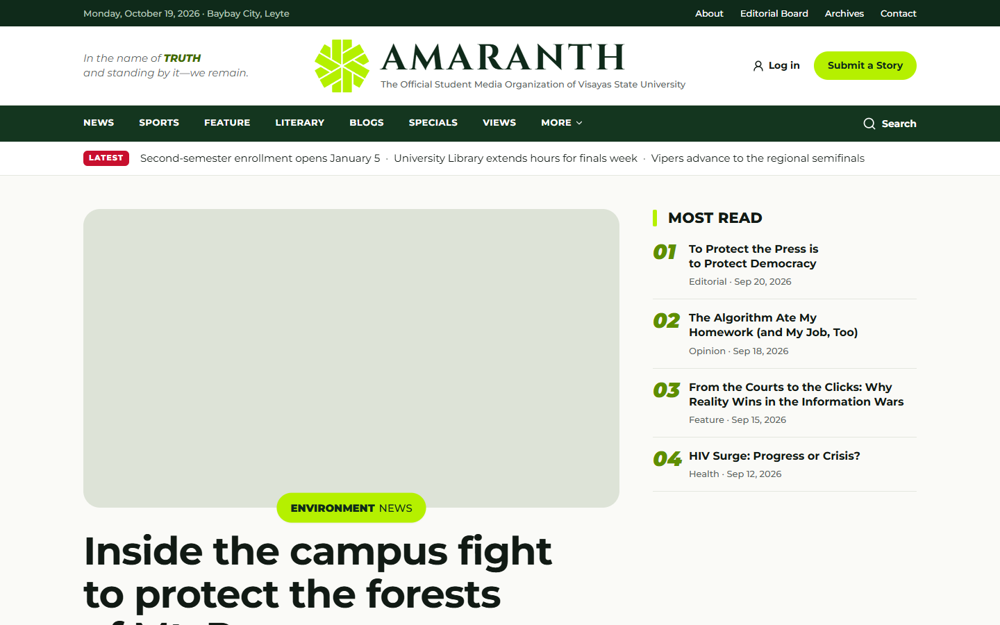
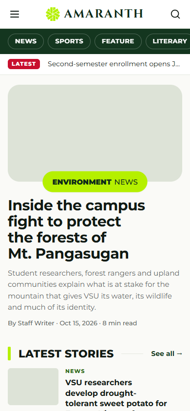
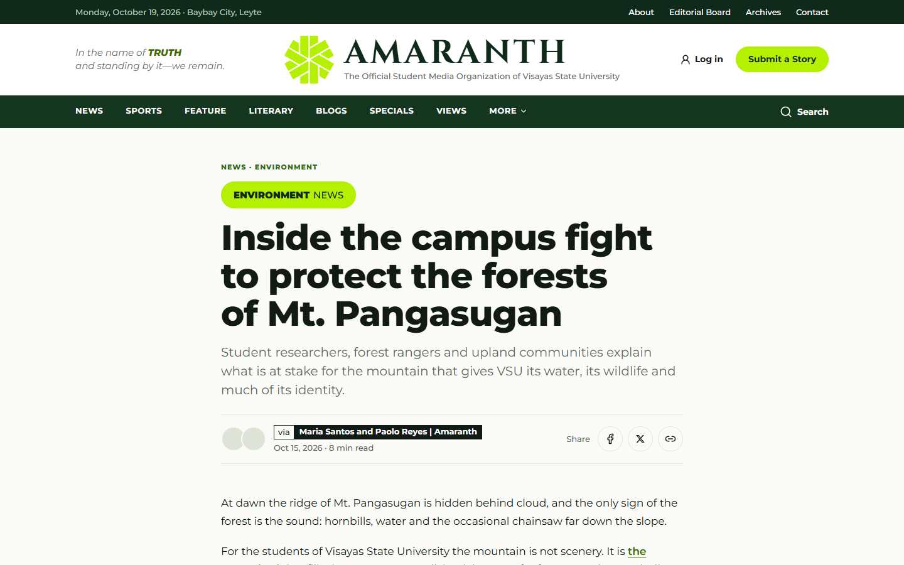
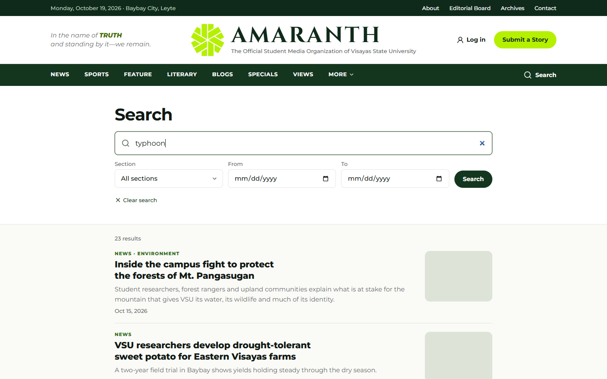
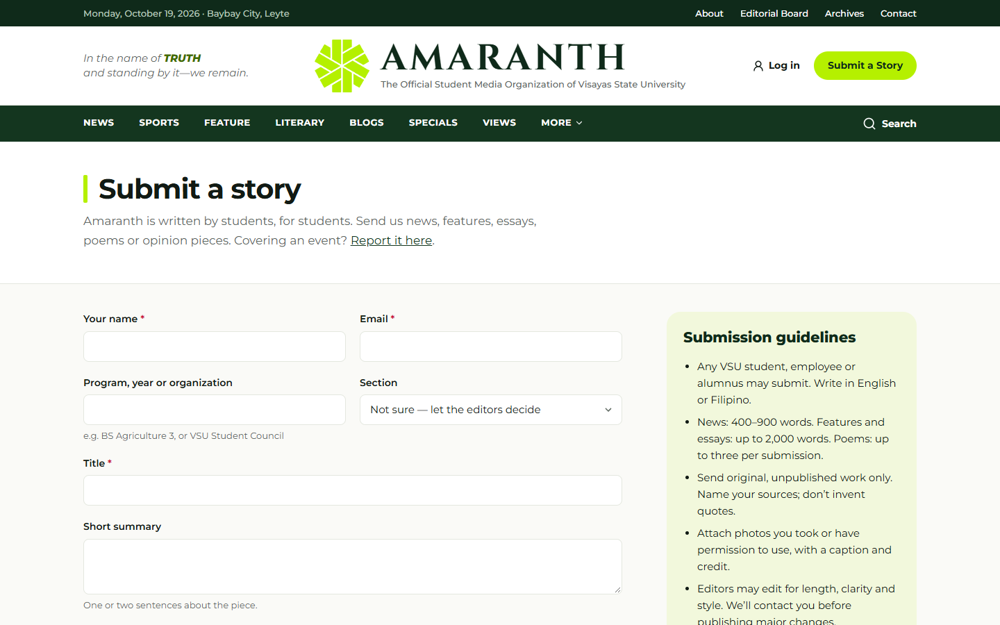
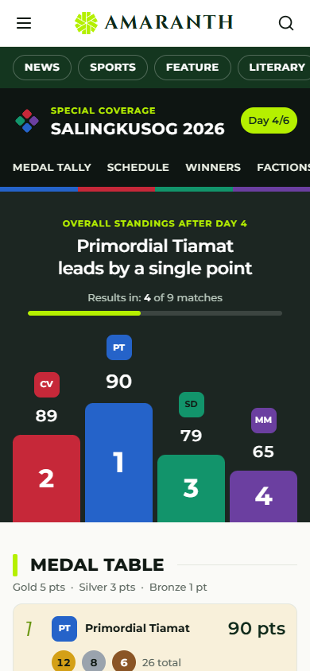

# Document control

| Field | Value |
|---|---|
| Title | User Manual — Public Readers |
| Document ID | AMR-DOC-11d |
| Version | 1.0 |
| Date | 2026-10-19 |
| Author | Amaranth development team [TO CONFIRM: names] |
| Status | Final draft |

# Contents

1. Finding your way
2. Reading an article
3. Search and archives
4. Commenting
5. Submitting a story or reporting an event
6. Contacting the newsroom
7. Following Salingkusog
8. Privacy

\newpage

# 1. Finding your way

The home page shows the lead story, the latest headlines ticker, **Most read**, **Latest stories**, the **Literary Folio**, Sports and Views. The green menu lists the main sections (News, Sports, Feature, Literary, Blogs, Specials, Views); **More** opens Science & Technology, Investigative, Explainer, Bulletin and Stories. On phones, swipe the section chips under the header.

Each section has its own landing page and an "all stories" list you can filter by category.

# 2. Reading an article

An article shows its section, headline, summary, byline, date and reading time, the cover photo, the story, tags, related stories and share buttons (Facebook, Messenger, X, and more sharing options on phones). You do not need an account.

# 3. Search and archives

- **Search** (magnifier in the menu): type words; filter by section and dates. Tag links show all stories with that tag.
- **Archives**: browse stories by month and download print issues as PDF.

# 4. Commenting

1. Under an article, write your name, email and comment, then **Post comment**.
2. A quick security check runs in the background (rarely a box to tick).
3. Comments appear **after an editor approves them**. Your email is never shown publicly.
4. You can reply to approved comments. Up to 5 comments per email every 10 minutes.

# 5. Submitting a story or reporting an event

- **Submit a Story** (header button or `/submit`): your name, email, affiliation, section, title, summary and text, plus up to **5 files of up to 20 MB** each (JPG, PNG, WebP, PDF, Word or text). Tick the consent box and send. Editors review every submission.
- **Report an Event** (`/submit/event`): organisation, contact, event title, date, venue and summary, with optional files.

Up to 3 submissions and 3 event reports per email per hour.

# 6. Contacting the newsroom

`/contact` lists the desks. Choose a topic (general, editorial, submission, technical, advertising, feedback), write your message and send. Up to 3 messages per email every 10 minutes.

# 7. Following Salingkusog

- `/salingkusog` — the medal tally: podium, "Results in: X of Y matches", the medal table, the points race (switch between 1h, 3h, 6h, 12h and Day), and live games. It updates by itself while open.
- **Schedule & Results** — day by day, filter by sport, faction or venue.
- **Winners**, **Factions**, **Sports** (brackets, standings, contest results), **Venues** (with map).
- When every match is final, the page says **Official and final medal tally**.

# 8. Privacy

Amaranth counts visits without cookies and without storing your IP address; if your browser sends "Do Not Track", only an anonymous pageview is counted. See `/privacy` for details and your rights under the Data Privacy Act of 2012.
