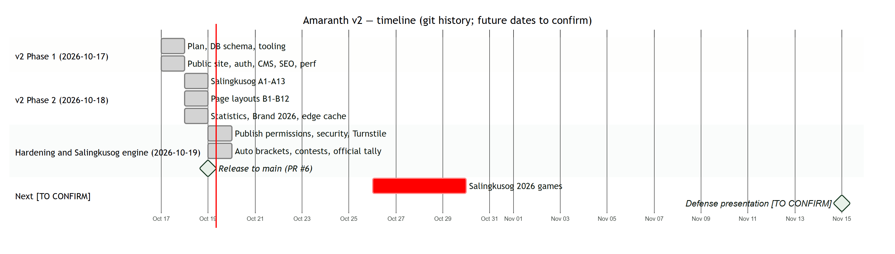

# Document control

| Field | Value |
|---|---|
| Title | Project Management Documents |
| Document ID | AMR-DOC-12 |
| Version | 1.0 |
| Date | 2026-10-19 |
| Author | Amaranth development team [TO CONFIRM: names] |
| Status | Final draft for defense |
| Sources | git history (183 commits, 82 merged branches), `docs/v2/PLAN.md`, `docs/v2/PLAN-PHASE2.md`, `docs/v2/PROGRESS.md` |

# Contents

1. Approach
2. Work breakdown structure (WBS)
3. Timeline
4. Milestones
5. Risk register
6. Cost and resources
7. Change log
8. Lessons learned

\newpage

# 1. Approach

Incremental delivery, **one feature per branch**: each feature branch starts from `develop`, passes the gates (`npm run check`, and `npm run db:test` for database work), is merged with a merge commit into `develop`, and is recorded in `docs/v2/PROGRESS.md`. Plans were approved before large changes (`docs/v2/PLAN.md`, `PLAN-PHASE2.md`). Releases go to `main` through a pull request.

# 2. Work breakdown structure (WBS)

| WBS | Work package | Branches (examples) | Status |
|---|---|---|---|
| 1 | Project setup | `docs/phase2-plan`, `feature/tooling-design-system` | Done |
| 2 | Database | `feature/db-v2-schema`, `feature/salingkusog-db`, `feature/statistics` | Done |
| 2.1 | Newsroom schema, RLS, workflow | `feature/db-v2-schema` | Done |
| 2.2 | Salingkusog schema and views | `feature/salingkusog-db` | Done |
| 2.3 | Statistics schema | `feature/statistics` | Done |
| 3 | Authentication and access | `feature/auth-staff`, `feature/publish-permissions`, `feature/salingkusog-team-access` | Done |
| 4 | Public site | `feature/public-shell-home`, `feature/section-pages`, `feature/article-page`, `feature/search-archives`, `feature/submissions-contact`, `feature/nav-more-menu`, `feature/section-*` (12) | Done |
| 5 | Newsroom (CMS) | `feature/cms-shell-dashboard`, `feature/cms-article-editor`, `feature/cms-editorial-workflow`, `feature/cms-media-library`, `feature/cms-people-board`, `feature/cms-site-settings` | Done |
| 6 | Salingkusog module | `feature/salingkusog-*` (13), `feature/sports-landing`, `feature/sk-*` (5), `feature/countdown-*` | Done |
| 6.1 | Setup, import, scorekeeper | `feature/salingkusog-cms-setup`, `feature/salingkusog-scorekeeper` | Done |
| 6.2 | Public hub | `feature/salingkusog-medal-tally`, `-schedule`, `-winners`, `-factions`, `-sports-bracket`, `-match-recap`, `-venues` | Done |
| 6.3 | Automation | `feature/sk-auto-brackets`, `feature/sk-contests`, `feature/sk-official-tally`, `feature/sk-points-race-ranges` | Done |
| 7 | Branding | `feature/brand-*` (6) | Done |
| 8 | SEO, performance | `feature/seo-sharing`, `feature/perf-pass`, `perf/edge-cache-images` | Done |
| 9 | Security | `fix/security-hardening`, `feature/turnstile-captcha` | Done |
| 10 | Quality and polish | `feature/v2-polish`, `fix/*` | Done |
| 11 | Documentation | `docs/*`, this package | In progress |
| 12 | Acceptance and release | PR #6 `develop` → `main` (merged); manual tests MT-01 – MT-20 | Release done; manual tests [TO CONFIRM] |

# 3. Timeline

| Period | Work | Evidence |
|---|---|---|
| 2025-09-23 – 2025-10-12 | v1 partial front end (16 commits) | git history |
| 2026-04-12 – 2026-04-13 | Interim admin and article pages (6 commits) | `feature/admin`, `feature/article-card`, `feature/article-details-page` |
| 2026-10-17 | v2 Phase 1: plan, database, tooling, public site, newsroom, SEO, performance (54 commits) | `docs/v2/PROGRESS.md` |
| 2026-10-18 | Phase 2: Salingkusog A1–A13, section layouts B1–B12, statistics, Brand 2026, edge cache (81 commits) | `docs/v2/PROGRESS.md` |
| 2026-10-19 | Publishing permissions, security, Turnstile, auto brackets, contests, official tally (25 commits so far) | `docs/v2/PROGRESS.md` |
| 2026-10-26 – 2026-10-30 | Salingkusog 2026 (from the live edition record) | `sk_editions` |
| [TO CONFIRM] | Defense presentation | — |

Note: the dense v2 dates reflect the commit history. Planning, design (Figma) and review time before and between commits are not visible in git [TO CONFIRM actual effort].

# 4. Milestones

| ID | Milestone | Date | Status |
|---|---|---|---|
| M1 | v2 plan approved | 2026-10-17 | Done |
| M2 | Newsroom and public site complete (Phase 1) | 2026-10-17 | Done |
| M3 | Salingkusog module and section layouts (Phase 2) | 2026-10-18 | Done |
| M4 | Brand 2026 approved by the Executive Editor and applied | 2026-10-18 | Done |
| M5 | Security hardening and CAPTCHA | 2026-10-19 | Done |
| M6 | Automatic brackets, round robins and contests | 2026-10-19 | Done |
| M7 | Release to `main` (pull request #6) | 2026-10-19 | Done |
| M8 | Salingkusog 2026 run on the system | 2026-10-26 – 30 | Upcoming |
| M9 | Defense | [TO CONFIRM] | Upcoming |

\newpage

# 5. Risk register

Likelihood (L) and impact (I): 1 low – 3 high; score = L × I.

| ID | Risk | L | I | Score | Mitigation | Owner |
|---|---|---|---|---|---|---|
| RK-01 | Database rule change breaks a role's access | 2 | 3 | 6 | 278 SQL checks; re-runnable files; backup before paste | Technical lead |
| RK-02 | Internet or Supabase outage during the games | 2 | 3 | 6 | Paper score sheets as fallback; enter results afterwards; status page monitoring | Salingkusog team |
| RK-03 | Wrong official result published | 2 | 3 | 6 | Medals need staff confirmation; corrections recompute the tally; audit of team | Managing Editor |
| RK-04 | Admin account compromised | 1 | 3 | 3 | Invite-only; deactivate quickly; MFA recommended (R-03) | Super admin |
| RK-05 | Free-tier limits exceeded during peak traffic | 2 | 2 | 4 | Edge cache; CDN; monitor usage [TO CONFIRM plan limits] | Technical lead |
| RK-06 | Knowledge loss when developers graduate | 3 | 2 | 6 | This documentation; developer guide; simple stack | Adviser |
| RK-07 | No CI lets a regression reach production | 2 | 2 | 4 | Gates in workflow; add CI (R-05) | Technical lead |
| RK-08 | Privacy complaint about published athlete data | 1 | 2 | 2 | Minimal data; consent for photos; update `/privacy` (R-10, R-12) | Executive Editor |
| RK-09 | Spam on public forms | 2 | 1 | 2 | Turnstile, rate limits, moderation | Editors |
| RK-10 | Vendor lock-in (Supabase/Vercel) | 1 | 2 | 2 | Plain PostgreSQL schema; standard React app | Technical lead |

# 6. Cost and resources

| Item | Plan | Cost |
|---|---|---|
| Supabase | Database, Auth, Storage, Realtime | [TO CONFIRM plan and monthly cost] |
| Vercel | Hosting, functions | [TO CONFIRM plan] |
| Cloudflare Turnstile | CAPTCHA | Free tier |
| Domain | [TO CONFIRM] | [TO CONFIRM] |
| Software | Open-source libraries (MIT/Apache licences) | none |
| People | Developer(s), editorial reviewers, adviser | [TO CONFIRM] |
| Hardware | Personal laptops and phones | none |

# 7. Change log

Merged branches by date (from `git log --merges`):

| Date | Merged into `develop` |
|---|---|
| 2026-04-12/13 | `feature/admin`, `feature/article-card`, `feature/article-details-page` |
| 2026-10-17 | `feature/db-v2-schema`, `feature/tooling-design-system`, `feature/auth-staff`, `feature/public-shell-home`, `feature/section-pages`, `feature/article-page`, `feature/search-archives`, `feature/submissions-contact`, `feature/cms-shell-dashboard`, `feature/cms-article-editor`, `feature/cms-editorial-workflow`, `feature/cms-media-library`, `feature/cms-people-board`, `feature/cms-site-settings`, `feature/seo-sharing`, `feature/v2-polish`, `feature/upgrade-tiptap-3`, `feature/upgrade-vite-7`, `feature/perf-pass`, `feature/salingkusog-db`, `feature/salingkusog-team-access`, `feature/salingkusog-cms-setup`, `fix/router-test-timeout`, `content/media-organization-copy`, `docs/phase2-plan`, `docs/release-pr` |
| 2026-10-18 | `feature/salingkusog-scorekeeper`, `-medal-tally`, `-schedule`, `-winners`, `-factions`, `-sports-bracket`, `-match-recap`, `-venues`, `-countdown`, `feature/sports-landing`, `feature/countdown-launch`, `feature/countdown-redesign`, `feature/nav-more-menu`, `feature/section-news`, `-feature`, `-literary`, `-blogs`, `-specials`, `-views`, `-science-technology`, `-investigative`, `-explainer`, `-bulletin`, `-stories`, `feature/statistics`, `feature/brand-tokens-fonts`, `-header-footer`, `-header-tagline`, `-components`, `-pages`, `-lime-hover`, `feature/literary-folio-photo`, `feature/logo-loader`, `perf/edge-cache-images`, `fix/nested-dialog-close`, `fix/server-esm-imports`, `fix/sk-more-categories`, `docs/pr-track-a`, `docs/stats-vercel-analytics`, `docs/track-b-wrapup` |
| 2026-10-19 | `feature/sk-chart-animations`, `feature/sk-points-race-ranges`, `feature/publish-permissions`, `fix/security-hardening`, `feature/sk-official-tally`, `feature/turnstile-captcha`, `feature/sk-auto-brackets`, `feature/sk-contests`, `fix/build-schedule-individual`, `fix/pre-release-polish`, `docs/pr-brand-2026`, `docs/pr-auto-brackets` |

Releases to `main`: pull requests #1, #2, #4, #5 and #6 (merge commits on `main`); #6 released everything up to commit `d7f6f34`.

# 8. Lessons learned

- Putting rules in the database made late changes (Business Manager role, publishing access) safe: one helper, tests, done.
- Re-runnable SQL removed deployment fear but requires discipline about order when access is narrowed.
- Fixture screens (`/dev`) let design and accessibility be checked without real data.
- A short pre-release review found real gaps (game form, schedule dates) that tests had not.
